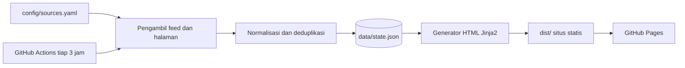

# Warta Hayati

[](https://github.com/warta-hayati/warta-hayati.github.io/actions/workflows/build.yml)

Agregator berita dan artikel bidang pertanian, perikanan, kehutanan, dan ilmu hayati dari sumber
Asia. Situs statis tanpa basis data, dibangun ulang setiap tiga jam.

- Situs: <https://warta-hayati.github.io>
- Status sumber: <https://warta-hayati.github.io/status/>
- Repositori: <https://github.com/warta-hayati/warta-hayati.github.io>

## Fitur

- Delapan topik: Pertanian, Perkebunan, Perikanan Tawar, Perikanan Payau/Laut, Kehutanan, Botani,
  Zoologi, Mikrobiologi.
- Label tingkat sumber: Pemerintah, Lembaga, Riset, Jurnal, Preprint, Media. Kotak preprint
  mencantumkan catatan bahwa isinya belum ditelaah sejawat.
- Filter bahasa (ID/EN) dan pencarian judul, keduanya berjalan di peramban tanpa server.
- Penemuan feed otomatis untuk sumber yang alamat feed-nya belum diketahui.
- Aksen warna per topik pada judul seksi, kepala kotak, tab, dan pita tepi atas.
- Tata letak ponsel: tab topik dibungkus, target sentuh minimal 44px, tabel status menjadi kartu.
- Riwayat judul per sumber, sehingga kotak tetap terisi ketika feed kosong atau gagal.
- Halaman status berisi sumber yang gagal dan kandidat yang belum aktif, serta halaman tentang
  berisi cara pakai dan jalur kontak.
- Ekspor `data.json`.
- Kotak tanpa judul disembunyikan dari beranda dan halaman topik.

## Instalasi

Prasyarat: Python 3.11 atau lebih baru.

```bash
git clone https://github.com/warta-hayati/warta-hayati.github.io.git warta-hayati
cd warta-hayati
python -m venv .venv
source .venv/bin/activate
pip install -e ".[dev]"
```

## Penggunaan

```bash
wartahayati build                        # ambil feed, bangun situs ke dist/
python -m http.server -d dist 8000       # sajikan hasilnya
```

Buka <http://localhost:8000>. Untuk memeriksa tampilan ponsel, buka
`http://<IP-lokal-komputer>:8000` dari ponsel di jaringan Wi-Fi yang sama; alamat IP komputer
terlihat dengan `hostname -I`.

| Perintah | Fungsi |
|---|---|
| `wartahayati build` | Ambil semua feed, lalu bangun situs. |
| `wartahayati fetch` | Ambil feed dan perbarui `data/state.json` tanpa membangun situs. |
| `wartahayati render` | Bangun situs dari `data/state.json` yang sudah ada. Cocok untuk mengubah templat. |
| `wartahayati check` | Ambil feed, cetak laporan kesehatan per sumber, dan keluar dengan kode 1 bila ada yang gagal. |

Opsi umum: `--config`, `--data`, `--out`, dan `-v` untuk log rinci.

## Konfigurasi

Sumber didaftarkan di [`config/sources.yaml`](config/sources.yaml):

```yaml
- id: kementan
  name: "Kementerian Pertanian RI"
  url: "https://www.pertanian.go.id/"
  tier: pemerintah                 # pemerintah, lembaga, riset, jurnal, preprint, media
  lang: id                         # id atau en
  topics: [pertanian, perkebunan]
  list: {item: "a:has(h4)", title: "h4", date: "time"}
  note: "Tanpa RSS. Berita dan pengumuman dibaca dari halaman depan memakai aturan 'list'."
```

Kunci yang dikenali: `feed` (URL eksplisit, bawaan `auto`), `include` (penyaring kata kunci),
`max_items` (bawaan 6), serta `enabled: false` beserta `note` untuk kandidat yang belum aktif.

Sumber tanpa RSS memakai aturan `list`. Aturan ini tidak boleh dipakai bersama `feed`.

```yaml
- id: fao-asia-pasifik
  name: "FAO Asia dan Pasifik"
  url: "https://www.fao.org/asiapacific/news/"   # halaman daftar berita
  tier: lembaga
  lang: en
  topics: [pertanian, perikanan-tawar, perikanan-laut, kehutanan]
  list:
    item: "div.d-list-news"          # wadah tiap berita
    title: "h5.title-link a"         # elemen judul
    date: "h6.date"                  # opsional: elemen tanggal
    summary: "div.d-list-content p"  # opsional: elemen ringkasan
    # link: "a"                      # opsional: bawaan tautan pertama di dalam item
    # date_in_title: false           # opsional: tanggal dibaca dari judul lalu dibuang
```

Pemilihnya sederhana: tag, `.kelas`, `#id`, `:has(...)`, hubungan keturunan dengan spasi, dan
gabungan dengan koma. Tanggal dikenali dalam bentuk `21-09-2026`, `23/10/2026`, `2026-10-27`,
`25 Oktober 2026`, dan `27 Okt 2026`, baik nama hari dan bulan Indonesia maupun Inggris. Pembaca
halaman daftar hanya memakai pustaka standar `html.parser`.

Aturan divalidasi saat config dimuat: kunci tak dikenal, nilai kosong, atau `list` bersama `feed`
ditolak dengan pesan yang menyebut id sumbernya.

Topik pertama pada `topics` menentukan tempat sumber tampil di beranda; halaman topik menampilkan
semua sumber yang memuat topik tersebut. Sumber yang melayani beberapa topik dengan penyaring
berbeda didaftarkan sebagai beberapa entri dengan `url` sama; pengambil hanya mengunduh satu kali
per alamat.

Setelah mengubah daftar, jalankan `wartahayati check` dan baca keluarannya. `pytest` ikut
memvalidasi struktur berkas, memastikan setiap topik punya sumber utama, dan memastikan setiap
sumber nonaktif membawa `note`.

### Kriteria sumber

1. Identitas penerbit dapat diverifikasi.
2. Ada kebijakan redaksi atau telaah sejawat yang dapat dibaca publik.
3. Jurnal terdaftar di DOAJ atau diterbitkan penerbit ilmiah mapan; penerbit dengan rekam jejak
   jurnal predator tidak diterima.
4. Sumber menyediakan feed atau halaman daftar yang dapat dibaca mesin.
5. Cakupannya relevan dengan Asia, atau sumber global dilengkapi penyaring `include`.
6. Sumber tidak menjadikan unggahan media sosial sebagai dasar pemberitaan.
7. Preprint wajib berlabel `preprint`.

Sumber yang belum memenuhi kriteria diberi `enabled: false` beserta `note`. Sumber yang feed-nya
gagal dimuat tidak dinonaktifkan: kegagalannya tampil di halaman status, judul lama tetap terisi
sampai feed-nya pulih, dan sumber itu kembali menyumbang judul begitu penerbit memperbaikinya.

Keadaan tiap sumber selalu terbaru di [halaman status](https://warta-hayati.github.io/status/),
tidak di berkas ini.

## Arsitektur



1. Pengambil memuat semua feed secara paralel. Sumber dengan `feed: auto` dicari lewat tag
   `<link rel="alternate">` dan jalur umum seperti `/feed/` dan `/rss.xml`; sumber tanpa RSS
   memakai aturan `list`.
2. Normalisasi membersihkan HTML dari judul, membuang parameter pelacak (`utm_*`, `fbclid`),
   menolak tautan selain http(s), lalu membuang duplikat berdasarkan URL dan judul.
3. Generator menulis `index.html`, satu halaman per topik, `status/`, `tentang/`, dan `data.json`.
4. Hanya judul, tanggal, dan tautan keluar yang disimpan. Isi artikel tidak disalin.

## Struktur repositori

```text
warta-hayati/
├── config/sources.yaml        daftar sumber, topik, dan tingkat
├── src/wartahayati/
│   ├── config.py              muat dan validasi konfigurasi
│   ├── fetcher.py             ambil feed, temukan feed, simpan riwayat
│   ├── listpage.py            baca daftar berita dari halaman tanpa RSS
│   ├── normalize.py           pembersihan, penyaring, penggabungan
│   ├── render.py              pembangun situs statis
│   └── cli.py                 perintah build, fetch, render, check
├── templates/                 templat Jinja2 (beranda, topik, status, tentang)
├── static/                    style.css, app.js, logo, dan ikon situs
├── tests/                     pengujian pytest
├── .github/workflows/build.yml
└── data/                      state.json dibuat saat dijalankan (tidak masuk Git)
```

## Pengujian

```bash
pytest -q
```

Pengujian mencakup pembersihan teks, penyaringan tautan tidak aman, deduplikasi, validasi
konfigurasi, pembacaan halaman daftar berita dari fixture HTML, dan pembangunan semua halaman
dengan data kosong. Sebagian pengujian menjaga hal yang mudah rusak tanpa terlihat: aturan warna
dan atribut `data-topik` setiap topik, titik henti ponsel serta target sentuh 44px, `data-label`
pada sel tabel status, keikutsertaan logo dan halaman `tentang/`, dan tidak bocornya jalur kontak
ke halaman selain `tentang/`.

## Menerbitkan

1. Dorong kode ke cabang `main`.
2. Di **Settings > Pages**, pilih **Build and deployment > Source: GitHub Actions**.
3. Jalankan workflow **Bangun dan terbitkan** sekali secara manual dari tab Actions.
4. Situs terbit di <https://warta-hayati.github.io/>. Semua tautan internal memakai alamat relatif,
   jadi situs juga berjalan di domain sendiri atau di subfolder.

Workflow berjalan setiap tiga jam dan menyimpan riwayat judul lewat `actions/cache`. Bila cache
terhapus, kotak terisi ulang dari feed terbaru pada putaran berikutnya. GitHub menonaktifkan
workflow terjadwal pada repositori publik setelah 60 hari tanpa aktivitas; satu commit kecil atau
tombol **Enable workflow** di tab Actions mengaktifkannya kembali.

## Kontribusi

Usulan sumber baru diajukan lewat issue atau pull request yang mengubah
[`config/sources.yaml`](config/sources.yaml). Sertakan alamat feed bila ada, tingkat sumber, dan
bukti bahwa kriteria sumber terpenuhi.

Bagi yang tidak memakai GitHub, usulan dan koreksi bisa dikirim lewat surel ke
<ekajogja@gmail.com>, atau lewat [halaman tentang](https://warta-hayati.github.io/tentang/) di
situs. Pengelola: Eka Y Saputra.

## Lisensi

MIT, lihat [LICENSE](LICENSE). Lisensi berlaku untuk kode; judul dan tautan tetap milik sumbernya.
