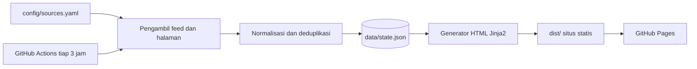

# Warta Hayati

Situs agregator berita dan artikel bidang pertanian, perikanan, kehutanan, dan ilmu hayati dari sumber tepercaya di Asia.

Situs: <https://warta-hayati.github.io>
Repositori: <https://github.com/warta-hayati/warta-hayati.github.io>

## Tujuan

Warta Hayati melayani petani, pekebun, pembudidaya ikan, ilmuwan, mahasiswa, dan pelajar di Indonesia yang ingin mengikuti perkembangan bidang ini langsung dari sumber primer. Situs menampilkan judul terbaru dari lembaga pemerintah, lembaga riset, jurnal, dan media yang lolos kriteria redaksi, tersusun padat pada satu halaman. Konten media sosial, algoritma rekomendasi, dan iklan tidak ada di dalamnya.

Tata letaknya mengikuti gaya Techurls: satu kotak per sumber, berisi enam judul terbaru dalam teks polos.

## Fitur

- Delapan topik: Pertanian, Perkebunan, Perikanan Tawar, Perikanan Payau/Laut, Kehutanan, Botani, Zoologi, dan Mikrobiologi.
- Label tingkat sumber pada setiap kotak: Pemerintah, Lembaga, Riset, Jurnal, Preprint, dan Media. Kotak *preprint* membawa catatan bahwa isinya belum ditelaah sejawat.
- Filter bahasa (ID, EN) dan pencarian judul. Keduanya berjalan di peramban, tanpa server.
- Penemuan *feed* otomatis untuk sumber yang alamat *feed*-nya belum diketahui.
- Riwayat judul per sumber, sehingga kotak tetap terisi ketika *feed* sedang kosong atau gagal.
- Kotak tanpa judul disembunyikan dari beranda dan halaman topik. Keadaan setiap sumber tampil di halaman `status/`.
- Halaman `status/` yang menampilkan sumber gagal, alasan galat, dan daftar kandidat yang belum aktif.
- Aksen warna per topik: garis judul, kepala kotak, tab, dan pita di tepi atas halaman memakai warna topik masing-masing (Pertanian hijau muda, Perkebunan hijau tua, Perikanan Tawar biru muda, Perikanan Payau/Laut biru tua, dan seterusnya), sehingga seksi mudah dikenali saat halaman digulir.
- Tampilan ponsel: di layar sempit tab topik dibungkus ke beberapa baris sehingga tidak perlu digeser mendatar, target sentuh minimal 44px, dan tabel status berubah menjadi kartu. Di layar lebar tab tetap satu baris dan lengket saat halaman digulir.
- Logo di kepala halaman, serta halaman `tentang/` berbahasa awam yang memuat cara pakai dan jalur kontak (surel pengelola dan situs pribadinya) untuk pembaca yang tidak memakai GitHub. Jalur kontak hanya ada di halaman itu — tidak ditempel di footer halaman lain — supaya daftar judul tetap bersih.
- Ekspor `data.json` untuk dipakai ulang oleh peneliti dan pengembang lain.
- Situs statis tanpa basis data. Biaya hosting nol di GitHub Pages.

## Tampilan

Warna topik didefinisikan di `static/style.css` sebagai empat variabel per topik: `--t` untuk garis, titik, dan pita, `--t-ink` untuk teks berwarna (judul seksi), `--t-solid` untuk latar berisi dengan teks putih (tab topik yang sedang aktif dan lencana tingkat), serta `--t-bg` untuk tint kepala kotak. Pemetaannya memakai atribut `data-topik` pada seksi topik, tab navigasi, dan pita tepi atas. Topik yang belum punya aturan warna otomatis memakai aksen hijau bawaan, jadi menambah topik di `config/sources.yaml` tidak pernah merusak tampilan.

Rasio kontras sudah diperiksa: `--t-ink` pada tint dan pada kartu minimal 4,5:1, `--t` pada latar minimal 3:1, dan teks putih di atas `--t-solid` minimal 4,75:1. Karena itu warna aksen yang terang seperti hijau muda tidak dipakai sebagai latar berteks putih: pada `#6E9427` teks putih hanya mencapai 3,54:1.

Halaman `tentang/` menjelaskan situs ini untuk pembaca awam dan memuat jalur kontak. Pengelola: Eka Y Saputra — <ekajogja@gmail.com>, <https://ekajogja.com>.

## Cara kerja



1. `config/sources.yaml` mendaftar sumber, topik, bahasa, tingkat, dan penyaring kata kunci.
2. Pengambil memuat semua *feed* secara paralel. Sumber dengan `feed: auto` dicari lewat tag `<link rel="alternate">` dan jalur umum seperti `/feed/` dan `/rss.xml`. Sumber tanpa RSS memakai aturan `list` untuk membaca daftar berita dari halaman biasa.
3. Normalisasi membersihkan HTML dari judul, membuang parameter pelacak (`utm_*`, `fbclid`), menolak tautan selain http(s), lalu membuang duplikat berdasarkan URL dan judul.
4. Generator menulis `index.html`, satu halaman per topik, `status/`, `tentang/`, dan `data.json`.
5. Hanya judul, tanggal, dan tautan keluar yang disimpan. Isi artikel tidak disalin.

## Struktur repositori

```text
warta-hayati/
├── config/sources.yaml        daftar sumber, topik, dan tingkat
├── src/wartahayati/
│   ├── config.py              muat dan validasi konfigurasi
│   ├── fetcher.py             ambil feed, temukan feed, simpan riwayat
│   ├── listpage.py            baca daftar berita dari halaman tanpa RSS
│   ├── normalize.py           pembersihan, penyaring, penggabungan
│   ├── render.py              pembangun situs statis
│   └── cli.py                 perintah build, fetch, render, check
├── templates/                 templat Jinja2
├── static/                    style.css (termasuk palet warna topik), app.js, logo, dan ikon situs
├── tests/                     pengujian pytest
├── .github/workflows/build.yml
└── data/                      state.json dibuat saat dijalankan (tidak masuk Git)
```

## Memulai

Prasyarat: Python 3.11 atau lebih baru.

```bash
git clone https://github.com/warta-hayati/warta-hayati.github.io.git
cd warta-hayati
python -m venv .venv
source .venv/bin/activate
pip install -e ".[dev]"

wartahayati build               # ambil feed, lalu bangun situs ke dist/
python -m http.server -d dist 8000
```

Buka <http://localhost:8000>.

| Perintah | Fungsi |
|---|---|
| `wartahayati build` | Ambil semua *feed*, lalu bangun situs. |
| `wartahayati fetch` | Ambil *feed* dan perbarui `data/state.json` tanpa membangun situs. |
| `wartahayati render` | Bangun situs dari `data/state.json` yang sudah ada. Cocok untuk mengubah templat. |
| `wartahayati check` | Ambil *feed*, cetak laporan kesehatan per sumber, dan keluar dengan kode 1 bila ada yang gagal. |

Opsi umum: `--config`, `--data`, `--out`, dan `-v` untuk log rinci.

## Mengelola sumber

Setiap sumber berupa satu entri di `config/sources.yaml`:

```yaml
- id: brin-agro
  name: "BRIN (Pertanian dan Perikanan)"
  url: "https://www.brin.go.id/"
  tier: riset                      # pemerintah, lembaga, riset, jurnal, preprint, media
  lang: id                         # id atau en
  topics: [pertanian, perikanan-tawar, kehutanan]
  include: [pertanian, perikanan, hutan]   # opsional: penyaring kata kunci
  # feed: "https://..."            # opsional: bawaan "auto"
  # max_items: 6                   # opsional
  # enabled: false                 # kandidat belum aktif
  # note: "alasan"                 # wajib diisi bila enabled: false
```

Sumber tanpa RSS memakai aturan `list` untuk membaca daftar berita dari halaman biasa. Aturan ini tidak boleh dipakai bersama `feed`.

```yaml
- id: fao-asia-pasifik
  name: "FAO Asia dan Pasifik"
  url: "https://www.fao.org/asiapacific/news/"   # halaman daftar berita
  tier: lembaga
  lang: en
  topics: [pertanian, perikanan-tawar, perikanan-laut, kehutanan]
  list:
    item: "div.d-list-news"          # wadah tiap berita
    title: "h5.title-link a"         # elemen judul
    date: "h6.date"                  # opsional: elemen tanggal
    summary: "div.d-list-content p"  # opsional: elemen ringkasan
    # link: "a"                      # opsional: bawaan tautan pertama di dalam item
    # date_in_title: false           # opsional: tanggal dibaca dari judul lalu dibuang
```

Pemilihnya sederhana: tag, `.kelas`, `#id`, `:has(...)`, hubungan keturunan dengan spasi, dan gabungan dengan koma. Tanggal dikenali dalam bentuk `21-09-2026`, `23/10/2026`, `2026-10-27`, `25 Oktober 2026`, dan `27 Okt 2026` (nama hari dan bulan Indonesia maupun Inggris, `list` hanya memakai pustaka standar `html.parser`). Aturan divalidasi saat config dimuat: kunci tak dikenal, nilai kosong, atau `list` bersama `feed` ditolak dengan pesan yang menyebut id sumbernya.

Topik pertama pada `topics` menentukan tempat sumber tampil di beranda. Halaman topik menampilkan semua sumber yang memuat topik tersebut. Sumber yang melayani beberapa topik dan memerlukan penyaring berbeda per topik didaftarkan sebagai beberapa entri dengan `url` sama. Pengambil hanya mengunduh satu kali per alamat.

Setelah mengubah daftar, jalankan `wartahayati check` dan baca keluarannya. Pengujian `pytest` ikut memvalidasi struktur berkas, memastikan setiap topik punya sumber utama, dan memastikan setiap sumber nonaktif membawa `note`.

### Kriteria masuk sumber

1. Identitas penerbit dapat diverifikasi.
2. Ada kebijakan redaksi atau telaah sejawat yang dapat dibaca publik.
3. Jurnal terdaftar di DOAJ atau diterbitkan penerbit ilmiah mapan. Penerbit dengan rekam jejak jurnal predator tidak diterima.
4. Sumber menyediakan *feed* atau halaman daftar yang dapat dibaca mesin.
5. Cakupannya relevan dengan Asia, atau sumber global dilengkapi penyaring `include`.
6. Sumber tidak menjadikan unggahan media sosial sebagai dasar pemberitaan.
7. *Preprint* wajib berlabel `preprint`.

Sumber yang belum memenuhi kriteria diberi `enabled: false` beserta `note`. Alasannya tampil di halaman status.

Sumber yang *feed*-nya gagal dimuat tidak dinonaktifkan. Kegagalannya tampil di halaman status, judul lama tetap terisi sampai *feed*-nya pulih, dan sumber itu kembali menyumbang judul begitu penerbit memperbaikinya.

## Sumber awal dan celah cakupan

Daftar sumber memuat 44 sumber aktif dan 10 kandidat yang menunggu penilaian redaksi: 34 sumber awal dari dua daftar bacaan terlampir, ditambah 9 sumber pengganti hasil penelusuran 2026-10-27 dan satu kementerian yang diaktifkan lewat pengambil halaman daftar berita.

### Keadaan *feed* (diuji 2026-10-27)

Semua alamat *feed* eksplisit dan penemuan otomatis sudah diuji dengan `wartahayati check`. Hasil build CI terakhir sebelum penambahan sumber: **17 dari 34 sumber aktif gagal dimuat**, dan tidak satu pun karena kesalahan alamat yang bisa diperbaiki dari sisi proyek ini.

Uji lokal terakhir (2026-10-27) mencatat **17 gagal dari 44 sumber aktif**. Tiga di antaranya hanya menolak jaringan lokal (Reviews in Aquaculture, Journal of Applied Aquaculture, dan Experimental Agriculture), jadi di CI tersisa **14 kegagalan**. Tidak satu pun dari sembilan sumber pengganti yang gagal, dan tidak satu pun dari empat sumber yang dibaca dari halaman daftar berita.

- **Tanpa RSS, dibaca dari halaman daftar:** Kementan (35 butir), FAO Asia-Pasifik (20), Kementerian Kehutanan (12), dan KKP (4). Halaman ini tidak menerbitkan *feed*, jadi dibaca memakai aturan `list`.
- **Tanpa RSS, belum terselesaikan:** BRIN (dua entri), SEARCA, CIFOR-ICRAF, dan AgriRxiv. Halaman beritanya dibuat JavaScript sehingga judulnya tidak ada di HTML mentah, tidak ada endpoint JSON (`/wp-json`, `/jsonapi`), dan jalur `/feed/` maupun `/rss.xml` alternatif sudah dicoba tanpa hasil.
- **Penerbit menghentikan RSS:** Trees, Forests and People dan Aquacultural Engineering (404 dari `rss.sciencedirect.com`), serta Agriculture and Food Security (alamat BMC menyajikan HTML, bukan XML).
- **Menolak bot dengan 403:** Forests, Plants, Diversity, dan Microorganisms (MDPI). Ini blokir akses, bukan *feed* yang hilang.
- **Aquaculture Research:** entri memakai ISSN daring `13652109`, mengikuti pola *Reviews in Aquaculture* yang berhasil. Alamat `most-recent` tetap 404 di kedua ISSN (`1355557x` dan `13652109`), jadi tidak ada alamat pengganti yang ditemukan.
- **Domain hilang:** JPHKA. Pada 2026-10-27 `ejournal.forda-mof.org` dialihkan ke domain parkir `tokenomica.com`, subdomain `jphka`, `ojs`, dan `publikasi` menjawab HTTP 530, dan `www.forda-mof.org` hanya menyisakan halaman 752 bita. Alamat baru tidak ditemukan, jadi entri JPHKA dibiarkan apa adanya sampai *feed*-nya pulih; cakupan kehutanan ditopang iForest dan Mongabay.
- **Diperbaiki:** SEAFDEC/AQD. Repositori `repository.seafdec.org.ph` menjawab 503, dialihkan ke `https://www.seafdec.org.ph/feed/` (20 entri, berhasil di CI).

Dua penerbit hanya menolak jaringan lokal dan berhasil di CI: Reviews in Aquaculture (Wiley) dan Journal of Applied Aquaculture (Taylor & Francis). Karena itu hasil `wartahayati check` dari jaringan lokal hanya untuk menapis; build CI yang menentukan. Pada uji lokal tercatat 20 kegagalan, tiga lebih banyak daripada CI.

### Sumber pengganti yang ditambahkan (diuji 2026-10-27)

Penelusuran pengganti menambahkan sembilan sumber aktif untuk topik yang cakupannya tipis. Setiap alamat di bawah sudah diuji dengan pengambil proyek ini dan menghasilkan entri pada 2026-10-27.

| Sumber | Topik | Feed | Entri | Terbaru |
|---|---|---|---|---|
| Botanical Studies | Botani | `link.springer.com/search.rss?facet-journal-id=40529` | 20 | 2026-10-15 |
| PhytoKeys | Botani | `phytokeys.pensoft.net/rss` | 100 | 2026-10-22 |
| ZooKeys | Zoologi | `zookeys.pensoft.net/rss` | 100 | 2026-10-27 |
| Journal of Threatened Taxa | Zoologi | `threatenedtaxa.org/index.php/JoTT/gateway/plugin/WebFeedGatewayPlugin/atom` | 30 | 2026-10-27 |
| MycoKeys | Mikrobiologi | `mycokeys.pensoft.net/rss` | 100 | 2026-10-26 |
| Indonesian Journal of Biotechnology | Mikrobiologi | `journal.ugm.ac.id/ijbiotech/gateway/plugin/WebFeedGatewayPlugin/atom` | 7 | 2026-09-30 |
| iForest | Kehutanan | `iforest.sisef.org/users/?action=rssxml` | 1204 | 2026-09-12 |
| Sugar Tech | Perkebunan | `link.springer.com/search.rss?facet-journal-id=12355` | 20 | 2026-10-23 |
| Jurnal Agro Industri Perkebunan | Perkebunan | `jurnal.polinela.ac.id/index.php/AIP/gateway/plugin/WebFeedGatewayPlugin/atom` | 8 | 2026-07-30 |

PhytoKeys, ZooKeys, MycoKeys, dan iForest berasal dari penerbit global, jadi keempatnya memakai penyaring kata kunci Asia sesuai kriteria 5. Pengukuran 2026-10-27 menunjukkan penyaring itu meloloskan 77 dari 100 entri (PhytoKeys), 69 dari 100 (ZooKeys), 89 dari 100 (MycoKeys), dan 193 dari 1204 (iForest), jadi kotaknya tetap terisi.

Sugar Tech diterbitkan Springer dan memenuhi kriteria 3 lewat jalur penerbit ilmiah mapan meskipun tidak terdaftar di DOAJ. Jurnal Agro Industri Perkebunan terdaftar di DOAJ.

Kandidat yang diuji dan tidak dimasukkan:

- **Journal of Forestry Research:** feed Springer terbaca, tetapi 20 entri teratasnya semuanya terbit 2016.
- **Jurnal Penelitian Kehutanan Wallacea:** 30 entri, terbaru 2025-12-30, di luar batas 90 hari.
- **International Microbiology:** hanya 4 dari 20 entri lolos penyaring Asia.
- **Journal of Rubber Research:** `facet-journal-id=42473` bukan jurnal itu; isi yang muncul meleset jauh dari topik.
- **Feed tidak ditemukan:** Berita Biologi, Microbiology Indonesia, Treubia, Zoo Indonesia, Zootaxa, Jurnal Hutan Tropis, Jurnal Belantara, Sylva Lestari, dan Jurnal Ilmu Kehutanan.
- **Domain mati:** `ejurnal.litbang.pertanian.go.id` tidak lagi melayani, sehingga Buletin Palma dan Jurnal Penelitian Tanaman Industri tidak bisa dipakai.
- **Biodiversitas:** feed sempat terbaca (99 entri), tetapi berulang kali timeout dan jurnalnya tidak ditemukan di DOAJ. Dijadikan kandidat dengan `enabled: false`.

**Celah cakupan yang diketahui:**

- Perkebunan kini dilayani Agroforestry Systems, Sugar Tech, dan Jurnal Agro Industri Perkebunan, ditambah Kementan yang sudah dibaca dari halaman depannya dan CIFOR-ICRAF yang belum menyediakan RSS. Tanaman industri Indonesia (sawit, karet, kopi, kakao, tebu) masih tipis karena domain `ejurnal.litbang.pertanian.go.id` mati; yang perlu ditelusuri adalah pusat penelitian di bawah Kementan lewat alamat baru.
- Botani, zoologi, dan mikrobiologi kini dilayani Botanical Studies, PhytoKeys, ZooKeys, Journal of Threatened Taxa, MycoKeys, dan Indonesian Journal of Biotechnology, di samping bioRxiv dan MDPI yang memblokir bot. Kebun raya dan museum zoologi di Asia belum ditemukan aliran yang layak.
- Kehutanan bertambah iForest. JPHKA belum terselesaikan dan jurnal kehutanan Indonesia lain belum punya feed yang hidup.
- Kementerian Kehutanan RI: aktif sejak 2026-10-27 lewat halaman <https://www.kehutanan.go.id/news> (pengganti `menlhk.go.id` setelah kementerian dipisah). Situsnya tidak menyediakan RSS, jadi dibaca dengan aturan `list` dan menyumbang 12 butir per putaran.
- Situs yang belum terselesaikan adalah BRIN, SEARCA, CIFOR-ICRAF, dan AgriRxiv, karena daftar beritanya dibuat JavaScript. Menyelesaikannya butuh peramban tanpa antarmuka (dependensi baru) atau endpoint JSON yang saat ini tidak tersedia.

**Sumber dari daftar bacaan yang sengaja tidak dimasukkan sebagai aliran berita:**

| Sumber | Alasan |
|---|---|
| AgWeb, Successful Farming | Fokus pada pasar dan produksi Amerika Serikat. |
| Fisheries and Aquaculture Journal (OMICS) | Penerbit berisiko tinggi sebagai jurnal predator. |
| Journal of Agricultural Science (CCSE) | Mutu penerbit belum terverifikasi. |
| Google Scholar, ResearchGate, Dimensions, CORE, OpenAIRE, PubMed, DOAJ, AGRIS, CABI Digital Library | Alat pencarian dan basis data. Tidak menyediakan aliran artikel terbaru yang tepat untuk kotak sumber. Calon isi halaman Referensi (lihat peta jalan). |
| Global Forest Watch | Berupa peta dan data peringatan, bukan aliran artikel. |
| ReliefWeb, Channel News Asia | Cakupan umum. Pertanian hanya sebagian kecil isinya. |

## Menerbitkan ke GitHub Pages

1. Dorong kode ke cabang `main` di <https://github.com/warta-hayati/warta-hayati.github.io>.
2. Buka **Settings > Pages**, lalu pilih **Build and deployment > Source: GitHub Actions**.
3. Jalankan *workflow* **Bangun dan terbitkan** sekali secara manual dari tab Actions.
4. Situs terbit di <https://warta-hayati.github.io/>. Seluruh tautan internal memakai alamat relatif, jadi situs juga berjalan di domain sendiri atau di subfolder.

*Workflow* berjalan setiap 3 jam. Riwayat judul disimpan lewat `actions/cache`. Bila cache terhapus, kotak terisi ulang dari *feed* terbaru pada putaran berikutnya.

GitHub menonaktifkan *workflow* terjadwal pada repositori publik setelah 60 hari tanpa aktivitas. Satu *commit* kecil atau tombol *Enable workflow* di tab Actions mengaktifkannya kembali.

## Pengujian

```bash
pytest -q
```

Pengujian mencakup pembersihan teks, penyaringan tautan tidak aman, deduplikasi, validasi konfigurasi, dan pembangunan semua halaman dengan data kosong.

## Hak cipta dan etika pengambilan data

- Situs hanya menampilkan judul, tanggal, dan tautan keluar. Hak atas isi tetap pada penerbit asli.
- Pengambil memakai *user agent* `WartaHayatiBot` yang mencantumkan alamat repositori, mengambil setiap alamat sekali per putaran, dan memakai *feed* yang memang diterbitkan untuk sindikasi.
- Penerbit yang ingin dikeluarkan dari daftar dapat membuka *issue* di repositori. Entri dihapus pada putaran berikutnya.
- Kode dilisensikan MIT (lihat `LICENSE`). Lisensi berlaku untuk kode saja. Judul dan tautan tetap milik sumber.

## Peta jalan

- Halaman **Referensi** berisi tautan pencarian ilmiah dan alur kerja penelusuran: Google Scholar dengan operator `site:`, DOAJ untuk memeriksa status akses terbuka, AGRIS, dan CORE.
- Pengambil OAI-PMH untuk repositori DSpace dan jurnal OJS Indonesia (Garuda, portal perguruan tinggi).
- Pemantauan otomatis perubahan struktur halaman untuk sumber `list`: memberi peringatan di halaman status bila jumlah butir turun mendadak.
- Peramban tanpa antarmuka opsional untuk situs berita ber-JavaScript (BRIN, SEARCA, CIFOR-ICRAF, AgriRxiv) — hanya bila dependensi tambahan disetujui.
- Terjemahan judul otomatis dari Inggris ke Indonesia.
- Penyaring Asia otomatis untuk sumber global.
- Mode gelap dan *self-hosting* huruf untuk menghilangkan ketergantungan pada Google Fonts. Warna topik sudah berupa variabel CSS (`--t`, `--t-ink`, `--t-bg`), jadi mode gelap tinggal menimpa ketiganya.

## Kontribusi

Usulan sumber baru diajukan lewat *issue* atau *pull request* yang mengubah `config/sources.yaml`. Sertakan alamat *feed* bila ada, tingkat sumber, dan bukti bahwa kriteria masuk terpenuhi.

Bagi yang tidak memakai GitHub, usulan dan koreksi bisa dikirim lewat surel ke <ekajogja@gmail.com>, atau lewat halaman `tentang/` di situs yang menyediakan tautan surel siap klik.
