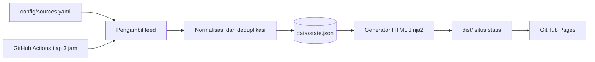

# Warta Hayati

Situs agregator berita dan artikel bidang pertanian, perikanan, kehutanan, dan ilmu hayati dari sumber tepercaya di Asia.

Situs: <https://warta-hayati.github.io>
Repositori: <https://github.com/warta-hayati/warta-hayati.github.io>

## Tujuan

Warta Hayati melayani petani, pekebun, pembudidaya ikan, ilmuwan, mahasiswa, dan pelajar di Indonesia yang ingin mengikuti perkembangan bidang ini langsung dari sumber primer. Situs menampilkan judul terbaru dari lembaga pemerintah, lembaga riset, jurnal, dan media yang lolos kriteria redaksi, tersusun padat pada satu halaman. Konten media sosial, algoritma rekomendasi, dan iklan tidak ada di dalamnya.

Tata letaknya mengikuti gaya Techurls: satu kotak per sumber, berisi enam judul terbaru dalam teks polos.

## Fitur

- Delapan topik: Pertanian, Perkebunan, Perikanan Tawar, Perikanan Payau/Laut, Kehutanan, Botani, Zoologi, dan Mikrobiologi.
- Label tingkat sumber pada setiap kotak: Pemerintah, Lembaga, Riset, Jurnal, Preprint, dan Media. Kotak *preprint* membawa catatan bahwa isinya belum ditelaah sejawat.
- Filter bahasa (ID, EN) dan pencarian judul. Keduanya berjalan di peramban, tanpa server.
- Penemuan *feed* otomatis untuk sumber yang alamat *feed*-nya belum diketahui.
- Riwayat judul per sumber, sehingga kotak tetap terisi ketika *feed* sedang kosong atau gagal.
- Halaman `status/` yang menampilkan sumber gagal, alasan galat, dan daftar kandidat yang belum aktif.
- Ekspor `data.json` untuk dipakai ulang oleh peneliti dan pengembang lain.
- Situs statis tanpa basis data. Biaya hosting nol di GitHub Pages.

## Cara kerja



1. `config/sources.yaml` mendaftar sumber, topik, bahasa, tingkat, dan penyaring kata kunci.
2. Pengambil memuat semua *feed* secara paralel. Sumber dengan `feed: auto` dicari lewat tag `<link rel="alternate">` dan jalur umum seperti `/feed/` dan `/rss.xml`.
3. Normalisasi membersihkan HTML dari judul, membuang parameter pelacak (`utm_*`, `fbclid`), menolak tautan selain http(s), lalu membuang duplikat berdasarkan URL dan judul.
4. Generator menulis `index.html`, satu halaman per topik, `status/`, dan `data.json`.
5. Hanya judul, tanggal, dan tautan keluar yang disimpan. Isi artikel tidak disalin.

## Struktur repositori

```text
warta-hayati/
├── config/sources.yaml        daftar sumber, topik, dan tingkat
├── src/wartahayati/
│   ├── config.py              muat dan validasi konfigurasi
│   ├── fetcher.py             ambil feed, temukan feed, simpan riwayat
│   ├── normalize.py           pembersihan, penyaring, penggabungan
│   ├── render.py              pembangun situs statis
│   └── cli.py                 perintah build, fetch, render, check
├── templates/                 templat Jinja2
├── static/                    style.css dan app.js
├── tests/                     pengujian pytest
├── .github/workflows/build.yml
└── data/                      state.json dibuat saat dijalankan (tidak masuk Git)
```

## Memulai

Prasyarat: Python 3.11 atau lebih baru.

```bash
git clone https://github.com/warta-hayati/warta-hayati.github.io.git
cd warta-hayati
python -m venv .venv
source .venv/bin/activate
pip install -e ".[dev]"

wartahayati build               # ambil feed, lalu bangun situs ke dist/
python -m http.server -d dist 8000
```

Buka <http://localhost:8000>.

| Perintah | Fungsi |
|---|---|
| `wartahayati build` | Ambil semua *feed*, lalu bangun situs. |
| `wartahayati fetch` | Ambil *feed* dan perbarui `data/state.json` tanpa membangun situs. |
| `wartahayati render` | Bangun situs dari `data/state.json` yang sudah ada. Cocok untuk mengubah templat. |
| `wartahayati check` | Ambil *feed*, cetak laporan kesehatan per sumber, dan keluar dengan kode 1 bila ada yang gagal. |

Opsi umum: `--config`, `--data`, `--out`, dan `-v` untuk log rinci.

## Mengelola sumber

Setiap sumber berupa satu entri di `config/sources.yaml`:

```yaml
- id: brin-agro
  name: "BRIN (Pertanian dan Perikanan)"
  url: "https://www.brin.go.id/"
  tier: riset                      # pemerintah, lembaga, riset, jurnal, preprint, media
  lang: id                         # id atau en
  topics: [pertanian, perikanan-tawar, kehutanan]
  include: [pertanian, perikanan, hutan]   # opsional: penyaring kata kunci
  # feed: "https://..."            # opsional: bawaan "auto"
  # max_items: 6                   # opsional
  # enabled: false                 # kandidat belum aktif
  # note: "alasan"                 # wajib diisi bila enabled: false
```

Topik pertama pada `topics` menentukan tempat sumber tampil di beranda. Halaman topik menampilkan semua sumber yang memuat topik tersebut. Sumber yang melayani beberapa topik dan memerlukan penyaring berbeda per topik didaftarkan sebagai beberapa entri dengan `url` sama. Pengambil hanya mengunduh satu kali per alamat.

Setelah mengubah daftar, jalankan `wartahayati check` dan baca keluarannya. Pengujian `pytest` ikut memvalidasi struktur berkas dan memastikan setiap topik punya sumber aktif.

### Kriteria masuk sumber

1. Identitas penerbit dapat diverifikasi.
2. Ada kebijakan redaksi atau telaah sejawat yang dapat dibaca publik.
3. Jurnal terdaftar di DOAJ atau diterbitkan penerbit ilmiah mapan. Penerbit dengan rekam jejak jurnal predator tidak diterima.
4. Sumber menyediakan *feed* atau halaman daftar yang dapat dibaca mesin.
5. Cakupannya relevan dengan Asia, atau sumber global dilengkapi penyaring `include`.
6. Sumber tidak menjadikan unggahan media sosial sebagai dasar pemberitaan.
7. *Preprint* wajib berlabel `preprint`.

Sumber yang belum memenuhi kriteria diberi `enabled: false` beserta `note`. Alasannya tampil di halaman status.

## Sumber awal dan celah cakupan

Daftar awal memuat 34 sumber aktif yang berasal dari dua daftar bacaan terlampir, ditambah 10 kandidat yang menunggu penilaian redaksi.

**Alamat *feed* belum diverifikasi.** Entri dengan `feed` eksplisit memakai pola URL dari masing-masing penerbit (MDPI, Wiley, Springer, ScienceDirect, Taylor & Francis, bioRxiv, BMC). Entri `feed: auto` bergantung pada penemuan otomatis. Jalankan `wartahayati check` dari jaringan yang terbuka sebelum penerbitan pertama, lalu perbaiki alamat yang gagal.

**Celah cakupan yang diketahui:**

- Perkebunan hanya dilayani Kementan, CIFOR-ICRAF, dan dua jurnal. Kandidat yang perlu ditelusuri: pusat penelitian kelapa sawit, karet, kopi, kakao, dan tebu di Indonesia.
- Botani dan zoologi bergantung pada *preprint*, jurnal MDPI, dan BRIN. Kandidat: kebun raya dan museum zoologi di kawasan Asia.
- Kementerian Kehutanan RI memerlukan verifikasi domain resmi.
- Sebagian besar situs kementerian tidak menyediakan RSS. Pengambil halaman daftar berita masih tahap rencana.

**Sumber dari daftar bacaan yang sengaja tidak dimasukkan sebagai aliran berita:**

| Sumber | Alasan |
|---|---|
| AgWeb, Successful Farming | Fokus pada pasar dan produksi Amerika Serikat. |
| Fisheries and Aquaculture Journal (OMICS) | Penerbit berisiko tinggi sebagai jurnal predator. |
| Journal of Agricultural Science (CCSE) | Mutu penerbit belum terverifikasi. |
| Google Scholar, ResearchGate, Dimensions, CORE, OpenAIRE, PubMed, DOAJ, AGRIS, CABI Digital Library | Alat pencarian dan basis data. Tidak menyediakan aliran artikel terbaru yang tepat untuk kotak sumber. Calon isi halaman Referensi (lihat peta jalan). |
| Global Forest Watch | Berupa peta dan data peringatan, bukan aliran artikel. |
| ReliefWeb, Channel News Asia | Cakupan umum. Pertanian hanya sebagian kecil isinya. |

## Menerbitkan ke GitHub Pages

1. Dorong kode ke cabang `main` di <https://github.com/warta-hayati/warta-hayati.github.io>.
2. Buka **Settings > Pages**, lalu pilih **Build and deployment > Source: GitHub Actions**.
3. Jalankan *workflow* **Bangun dan terbitkan** sekali secara manual dari tab Actions.
4. Situs terbit di <https://warta-hayati.github.io/>. Seluruh tautan internal memakai alamat relatif, jadi situs juga berjalan di domain sendiri atau di subfolder.

*Workflow* berjalan setiap 3 jam. Riwayat judul disimpan lewat `actions/cache`. Bila cache terhapus, kotak terisi ulang dari *feed* terbaru pada putaran berikutnya.

GitHub menonaktifkan *workflow* terjadwal pada repositori publik setelah 60 hari tanpa aktivitas. Satu *commit* kecil atau tombol *Enable workflow* di tab Actions mengaktifkannya kembali.

## Pengujian

```bash
pytest -q
```

Pengujian mencakup pembersihan teks, penyaringan tautan tidak aman, deduplikasi, validasi konfigurasi, dan pembangunan semua halaman dengan data kosong.

## Hak cipta dan etika pengambilan data

- Situs hanya menampilkan judul, tanggal, dan tautan keluar. Hak atas isi tetap pada penerbit asli.
- Pengambil memakai *user agent* `WartaHayatiBot` yang mencantumkan alamat repositori, mengambil setiap alamat sekali per putaran, dan memakai *feed* yang memang diterbitkan untuk sindikasi.
- Penerbit yang ingin dikeluarkan dari daftar dapat membuka *issue* di repositori. Entri dihapus pada putaran berikutnya.
- Kode dilisensikan MIT (lihat `LICENSE`). Lisensi berlaku untuk kode saja. Judul dan tautan tetap milik sumber.

## Peta jalan

- Halaman **Referensi** berisi tautan pencarian ilmiah dan alur kerja penelusuran: Google Scholar dengan operator `site:`, DOAJ untuk memeriksa status akses terbuka, AGRIS, dan CORE.
- Pengambil OAI-PMH untuk repositori DSpace dan jurnal OJS Indonesia (Garuda, portal perguruan tinggi).
- Pengambil halaman daftar berita untuk situs kementerian tanpa RSS, dengan pemantauan otomatis atas perubahan struktur halaman.
- Terjemahan judul otomatis dari Inggris ke Indonesia.
- Penyaring Asia otomatis untuk sumber global.
- Mode gelap dan *self-hosting* huruf untuk menghilangkan ketergantungan pada Google Fonts.

## Kontribusi

Usulan sumber baru diajukan lewat *issue* atau *pull request* yang mengubah `config/sources.yaml`. Sertakan alamat *feed* bila ada, tingkat sumber, dan bukti bahwa kriteria masuk terpenuhi.
